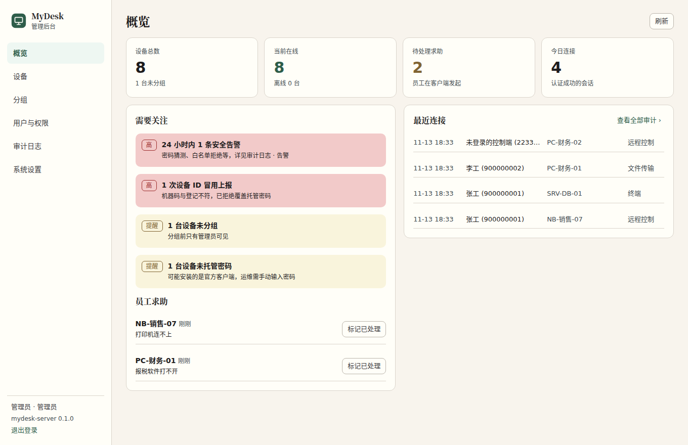
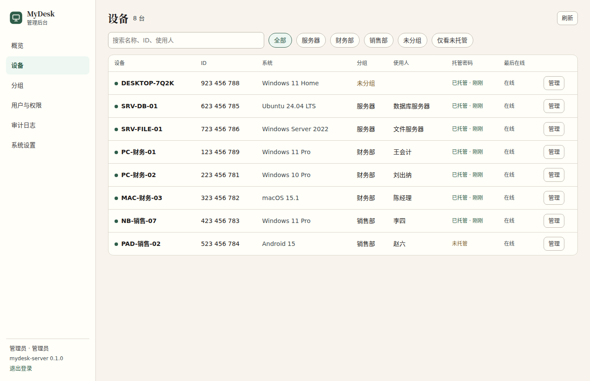
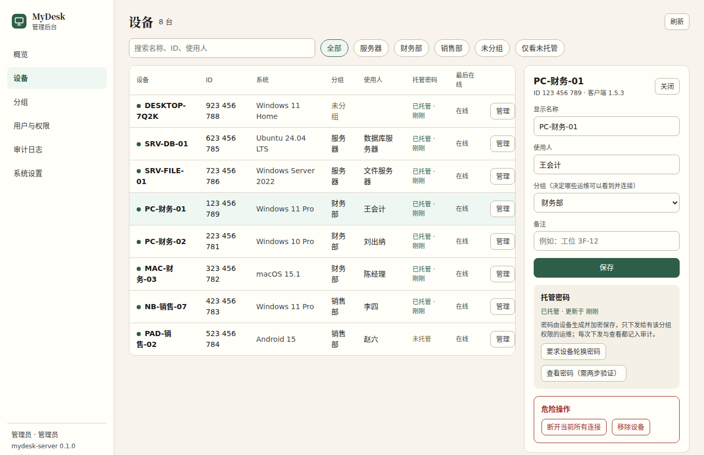
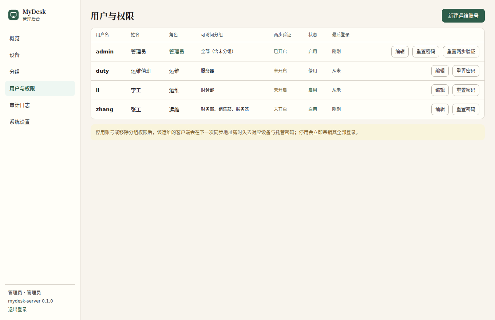
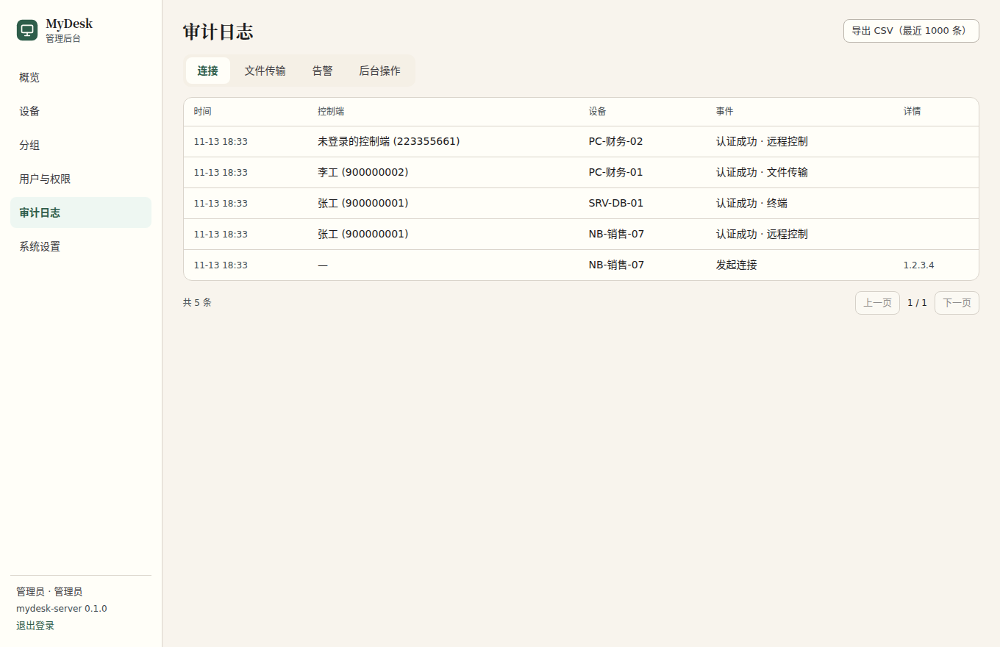
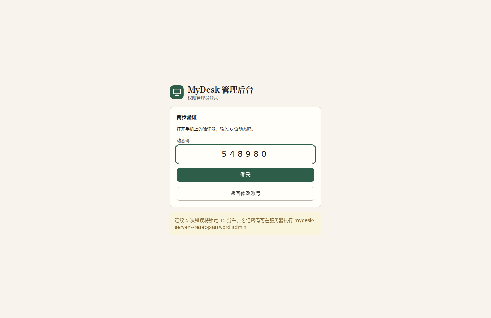
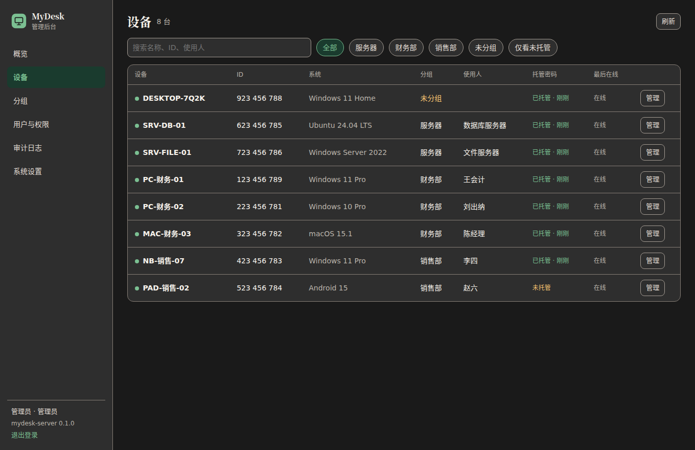
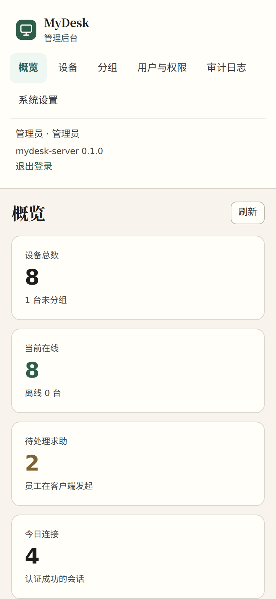

# mydesk-server

MyDesk 远程运维平台的服务端：**一个文件**同时提供

- ID / 信令服务与中继服务（官方 RustDesk Server 1.1.17，未修改）
- 账号 API（兼容 RustDesk 客户端：登录、地址簿、设备上报、审计）
- 托管密码：设备生成的随机永久密码加密保存，只下发给有分组权限的运维
- Web 管理后台（默认 `https://你的域名/mydeskadmin/`，管理员强制两步验证）
- 内置 HTTPS（自动申请 Let's Encrypt 证书，或使用自备证书）

署名 M&J Group · 基于 RustDesk（AGPL-3.0），修改后的源码按 AGPL 提供。计划、决策与进度见 [docs/v1/](docs/v1/)。

## 部署（Linux）

### 1. 准备

- 一台有公网 IP 的 Linux 服务器（x86_64 或 arm64），1 核 1G 即可起步；中继流量大时按带宽选型。
- 一个域名解析到该服务器，例如 `rd.example.com`。
- 防火墙 / 安全组放行：

| 端口 | 协议 | 用途 |
| --- | --- | --- |
| 21115 | TCP | NAT 类型探测 |
| 21116 | TCP + UDP | ID 注册与打洞 |
| 21117 | TCP | 中继 |
| 21118、21119 | TCP | 网页客户端用 WebSocket（可不开） |
| 443 | TCP | 账号 API、管理后台、证书自动申请 |

### 2. 安装

从 GitHub Actions 的构建产物下载 `mydesk-server-linux-amd64`（或 arm64），然后：

```bash
sudo install -m 755 mydesk-server /usr/local/bin/mydesk-server
sudo useradd --system --home /var/lib/mydesk --create-home mydesk
sudo cp scripts/mydesk-server.service /etc/systemd/system/
sudo sed -i 's/rd.example.com/你的域名/' /etc/systemd/system/mydesk-server.service
sudo systemctl daemon-reload && sudo systemctl enable --now mydesk-server
journalctl -u mydesk-server -f     # 看到“服务器公钥”和“Let's Encrypt 自动证书”即正常
```

首次启动会在 `/var/lib/mydesk/data/` 生成：

| 文件 | 说明 |
| --- | --- |
| `id_ed25519` / `id_ed25519.pub` | 服务器密钥对。**公钥要填进客户端构建变量**；丢失后所有客户端需重新打包 |
| `master.key` | 托管密码的主密钥。丢失后所有托管密码无法解密（设备会在下次上报时自动补上） |
| `mydesk.db` | 账号、设备、审计数据 |
| `admin-initial-password.txt` | 管理员 admin 的初始密码，登录后请删除 |
| `acme/` | 证书缓存 |

### 3. 登录后台

浏览器打开 `https://你的域名/mydeskadmin/`，用 `admin` 和初始密码登录，按提示用手机验证器（Google Authenticator、Microsoft Authenticator、腾讯身份验证器）扫码绑定两步验证。

然后：新建分组 → 新建运维账号并授权分组 → 客户端上线后在“设备”中给设备分组。

### 4. 打包客户端

在客户端仓库 `mydesk-client` 的 Settings → Secrets and variables → Actions → Variables 中设置：

| 变量 | 值 |
| --- | --- |
| `MYDESK_SERVER_HOST` | 你的域名 |
| `MYDESK_SERVER_KEY` | `data/id_ed25519.pub` 的内容（后台“系统设置”可一键复制） |
| `MYDESK_API_SERVER` | `https://你的域名` |
| `MYDESK_ORG_NAME` | （可选）单位名称，显示在被控端界面 |

然后在 Actions 中手动运行 “MyDesk build”。

## 常用参数

```
mydesk-server --help
```

| 参数 | 说明 |
| --- | --- |
| `--data-dir <DIR>` | 数据目录，默认 `./data` |
| `--domain <DOMAIN>` | 开启 HTTPS 并自动申请证书（需公网 443） |
| `--tls-cert <FILE> --tls-key <FILE>` | 使用自备证书（内网部署） |
| `--admin-path <PATH>` | 后台路径，默认 `mydeskadmin` |
| `--admin-allow <CIDR,...>` | 只允许这些网段访问后台，例如公司出口 IP |
| `--reset-password <用户名>` | 重置密码并打印后退出（忘记管理员密码时用） |

开启 HTTPS 后，明文端口 21114 只监听本机。

## 备份

停服务后备份整个 `data/` 目录即可（`id_ed25519*`、`master.key`、`mydesk.db*` 缺一不可）：

```bash
sudo systemctl stop mydesk-server
sudo tar czf mydesk-backup-$(date +%F).tgz -C /var/lib/mydesk data
sudo systemctl start mydesk-server
```

## 界面截图

| 概览 | 设备 |
| --- | --- |
|  |  |
| 设备详情 | 用户与权限 |
|  |  |
| 审计日志 | 两步验证登录 |
|  |  |
| 深色模式 | 手机 |
|  |  |

截图由 CI 用真实程序和演示数据生成（`scripts/screenshots/`）。

## 开发

本机无需 Rust 工具链也可开发前端：`cd web && npm ci && npm run dev`。服务端编译与全部测试在 GitHub Actions 进行（`.github/workflows/build.yml`），冒烟测试 `scripts/smoke.sh` 覆盖端口、账号 API、托管密码、后台与 HTTPS。
